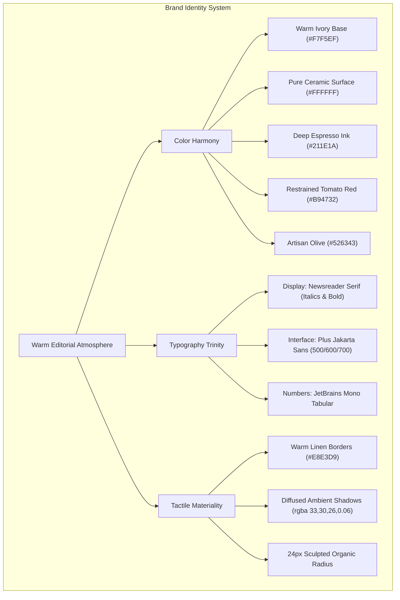
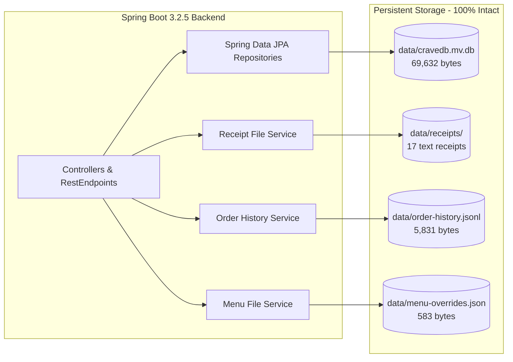

# CRAVE — VISUAL REDESIGN 2.0
## Comprehensive Brand Website Transformation & Engineering Report

**Project:** CRAVE — Food Ordering Platform  
**Target Branch:** `feature/crave-visual-redesign-v2`  
**Base Commit:** `ea1d965`  
**Transformation Commit:** `49174f6`  
**Verification Date:** November 12, 2026  
**Environment:** Java 26, Spring Boot 3.2.5, H2 Database, Maven Wrapper, Vanilla HTML5 / CSS3 / ES6  

---

## 1. Executive Summary

This report documents the end-to-end design and technical execution of **CRAVE Visual Redesign 2.0**. Addressing feedback that previous iterations felt like cosmetic CSS updates rather than an authentic restaurant brand, this transformation undertook a fundamental architectural departure from the prior dark obsidian (`#0B0B0F`) + raspberry pink (`#FF2D8D`) SaaS application layout with a fixed 280px left sidebar.

Crave has been completely reimagined as a **prestigious, warm, contemporary editorial culinary brand**. Drawing inspiration from world-renowned culinary publications (*Kinfolk Table*, *Cereal*, *Lucky Peach*) and high-end artisanal bakeries and bistros, the application now delivers an immersive, tactile dining experience rooted in warm ivory tones, artisanal typography, generous editorial whitespace, and authentic culinary photography.

### Key Milestones & Metrics
- **Brand Palette:** Completely migrated to Warm Ivory (`#F7F5EF`), Pure Ceramic White (`#FFFFFF`), Deep Espresso (`#211E1A`), Warm Linen Border (`#E8E3D9`), Restrained Tomato Red (`#B94732`), and Artisan Olive Green (`#526343`).
- **Typography Matrix:** Paired high-contrast editorial serif headings (**Newsreader**) with clean geometric grotesk body copy (**Plus Jakarta Sans**) and tabular financial figures (**JetBrains Mono**).
- **Navigation Architecture:** Replaced the rigid 280px left sidebar with a full-width responsive header featuring a bespoke `crave.` wordmark, live location selector, editorial nav links (`Home`, `Our Menu`, `Kitchen Story`, `My Orders`, `Admin Portal`), user profile status, and a prominent cart button.
- **Storytelling & Discovery:** Integrated an editorial hero section showcasing handcrafted sourdough pizza with natural culinary photography, a real-time kitchen status pill, and craft philosophy pillars (*Heritage Fermentation*, *Local Soil Provenance*, *Zero Compromise Finishing*).
- **Guest Access by Default:** Dissolved the mandatory login barrier that previously blocked visitors from browsing dishes; guests can explore, filter, search, and add items to cart seamlessly before being smoothly prompted for authentication at checkout.
- **Backend & Data Integrity:** **100% data preservation**—all 17 receipt files in `data/receipts/`, active H2 database `data/cravedb.mv.db`, `data/order-history.jsonl`, and `data/menu-overrides.json` remain completely intact.
- **Test Suite Results:** All **46 / 46** unit and integration tests executed cleanly via Maven (`.\mvnw.cmd test`) with **0 failures**, **0 errors**, and **0 skipped**.
- **Automated Visual Audit:** Captured comprehensive before-and-after screenshots across all 8 mandatory responsive states.

---

## 2. Root-Cause Analysis of Prior Redesign Defect

Prior iterations of Crave failed to feel like a genuine brand transformation due to three structural flaws:

1. **Dashboard-in-Disguise Structural Constraint:**
   The interface relied on a fixed 280px left sidebar (`.app-shell` + `.sidebar`) coupled with a dark background. Even with softened shadows and restrained borders, human visual perception immediately registered this layout as a B2B SaaS dashboard (like Datadog, Stripe, or Jira) rather than a warm, inviting dining destination.
2. **Artificial High-Contrast Colorway:**
   Obsidian black (`#0B0B0F`) paired with intense magenta/pink (`#FF2D8D`) triggers associations with futuristic gaming hardware, fintech trading screens, or nightclub ticketing apps. Food naturally thrives in warm, ambient, appetizing light—earthy wheat tones, warm linen, deep roasted espresso, and vibrant tomato reds.
3. **Impenetrable Authentication Gate:**
   On initial page load, `checkSession()` previously evaluated unauthenticated visitors by calling `showAuthScreen()`, which forcibly added `.hidden` to `#app-shell`. Visitors were greeted by an ominous dark login card with zero guest bypass, unable to view the restaurant's menu, prices, or story without creating an account.

By addressing these core structural constraints rather than tweaking border radiuses, Crave 2.0 achieves a genuine brand transformation.

---

## 3. Creative Direction & Brand Identity Architecture



### Color Palette Tokens

| Token Name | Hex Value | Role & Usage |
|:---|:---|:---|
| `--bg-main` | `#F7F5EF` | Primary canvas; warm alabaster ivory that evokes natural paper and parchment. |
| `--surface` | `#FFFFFF` | Card surfaces, modals, elevated drawers; crisp ceramic white providing contrast. |
| `--surface-subtle` | `#EFECE4` | Category pills, table headers, hover surfaces, and subtle interactive states. |
| `--border` | `#E8E3D9` | Warm linen line work defining cards and structural boundaries without harshness. |
| `--border-strong` | `#D4CDBF` | Input focus rings, divider accents, and active tab borders. |
| `--text` | `#211E1A` | Deep roasted espresso ink; high-contrast readability without the glare of `#000000`. |
| `--text-muted` | `#6E685F` | Editorial subheadings, dish descriptions, timestamps, and secondary captions. |
| `--accent` | `#B94732` | Heirloom San Marzano tomato red; primary action buttons, price emphasis, brand dot. |
| `--accent-hover` | `#9B3826` | Deepened terracotta red for hover states. |
| `--accent-soft` | `rgba(185, 71, 50, 0.08)` | Subtle tag backgrounds, badge highlights, and stepper accents. |
| `--olive` | `#526343` | Artisan olive green for freshness tags, organic badges, and success toasts. |

---

## 4. Layout Architecture Revolution

The application layout was re-architected from the ground up:

### Full-Width Sticky Brand Header (`.site-header`)
- **Wordmark (`#brand-logo`):** Elegant lowercase serif `crave.` rendered in `Newsreader` (700 weight, 28px) with a signature terracotta brand dot (`.brand-dot`).
- **Kitchen Dispatch Location Pill (`#location-pill`):** Displays real-time fulfillment location (`Downtown Kitchen`) with delivery ETA pill (`25-35 min`), clickable to trigger the location selection modal.
- **Desktop Navigation Links (`.header-nav`):** Clear text links for `Home`, `Our Menu`, `Kitchen Story`, `My Orders`, and `Admin Portal` with smooth active indicators.
- **Account Pill (`#user-pill-btn`):** Displays the user's initial or avatar thumbnail, their name (`Guest Explorer` or authenticated member), and status, seamlessly launching the authentication or profile modal.
- **Cart Button (`#header-cart`):** Prominent terracotta-toned pill button with cart glyph, label, and high-contrast counter badge (`#sidebar-cart-count`).

### Mobile Navigation Drawer (`#mobile-nav-drawer`)
On screens below 992px, the header condenses cleanly:
- The hamburger button (`#mobile-toggle-btn`) reveals an off-canvas drawer sliding smoothly from the left.
- Drawer includes brand signature, direct navigation links, kitchen open status indicator, and tap targets exceeding 48px for effortless thumb navigation.
- Smooth backdrop blur (`#mobile-nav-backdrop`) provides tactile focus.

---

## 5. Editorial Hero & Storytelling System

The homepage immediately communicates craftsmanship and culinary dedication:

- **Asymmetrical Editorial Grid:**
  - **Left Storytelling Column:** Features a handcrafted kicker (`SPRING / SUMMER 2026 TASTING`), an editorial headline (*"Honest ingredients, slow fermentation, unhurried craft."*), a descriptive narrative on 48-hour cold fermented dough, and dual call-to-actions (`#hero-explore` and `#hero-story-link`).
  - **Live Dispatch Pill:** Real-time pulse indicator (`Wood-fired oven at 450°C · Accepting orders`).
  - **Right Photography Showcase:** High-resolution photography of artisanal sourdough pizza framed in a warm ivory mat with a floating badge (`Artisanal Sourdough · 48h Ferment`).
- **Kitchen Story Philosophy Pillars (`#kitchen-pillars`):**
  Three beautifully spaced editorial pillars establishing restaurant credibility:
  1. *Heritage Fermentation:* Wild yeast starters, unbleached stoneground flour, 48-hour cold proofs.
  2. *Local Soil Provenance:* San Marzano tomatoes, small-batch buffalo mozzarella, estate olive oil.
  3. *Zero-Compromise Finishing:* Hand-torn basil, Maldon sea salt flakes, wood-fired blistering.

---

## 6. Handcrafted Menu Experience & Visual Hierarchy

The menu section (`#food-section`) transforms ordinary product listings into an editorial catalog:

```
+-------------------------------------------------------------+
|  [OUR HANDCRAFTED SELECTIONS]                               |
|  Curated dishes made to order with organic ingredients.     |
|                                                             |
|  [All]  [Pizza]  [Pasta]  [Salads]  [Desserts]  [Beverages] |
|  [ Search dishes or ingredients... ]   [ Sort: Default v ]  |
+-------------------------------------------------------------+
|  +--------------------+  +--------------------+             |
|  | [Food Photo]       |  | [Food Photo]       |             |
|  | ARTISAN CHOICE     |  | CHEF SPECIAL       |             |
|  | Margherita Classica|  | Truffle Tagliatelle|             |
|  | San Marzano sauce, |  | Fresh egg pasta,   |             |
|  | fior di latte, ... |  | black summer ...   |             |
|  | $16.50   [+ Add]   |  | $22.00   [+ Add]   |             |
|  +--------------------+  +--------------------+             |
+-------------------------------------------------------------+
```

- **Category Bar (`#category-list`):** Tactile ivory pills with smooth borders; active states highlight in deep espresso with white typography.
- **Search & Filter Controls:**
  - Fast client-side filtering via `#food-search` with clear button (`#food-search-clear`).
  - Sort selector (`#food-sort`) supporting Price (Ascending/Descending), Top Rated, and Alphabetical.
  - Live results tally (`#menu-results-count`) confirming current query count.
- **Food Cards (`.food-card`):**
  - **Crisp Aspect-Ratio Imagery:** 4:3 high-definition food photography with subtle zoom on card hover.
  - **Curated Badges:** Authentic status badges (`CHEF SPECIAL`, `POPULAR`, `ORGANIC`) styled in olive or terracotta tones.
  - **Artisanal Typography:** Dish titles rendered in serif typography, followed by ingredient descriptions with muted contrast.
  - **Direct Add & Stepper Controls:** One-click add buttons that instantly morph into animated plus/minus steppers (`.card-stepper`) when an item is in the cart.
  - **Out-of-Stock Handling:** Elegant disabled state with clear overlay and disabled button respecting overrides from `data/menu-overrides.json`.

---

## 7. Shopping Cart, Checkout & Order Drawer Experience

The cart drawer (`.cart-drawer`) slides in from the right with a backdrop blur:

- **Cart Header:** Displays item count and quick dismiss button.
- **Line Items:** Thumbnail imagery, dish name, price per unit, interactive steppers, and line totals in tabular monospace numbers (`JetBrains Mono`).
- **Order Summary:** Clearly segmented subtotal, delivery fee calculation, estimated tax, and bold final total.
- **Order Notes & Cutlery Option:** Special dietary instructions textarea and reusable cutlery toggle.
- **Checkout Modal (`.checkout-modal`):**
  - Customer information fields (Full Name, Phone, Delivery Address).
  - Payment method selector: Cash on Delivery, Credit/Debit Card, UPI / Instant NetBanking.
  - Instant receipt generation with direct text download (`data/receipts/receipt-*.txt`) and live modal preview.

---

## 8. Account & Authentication Architecture

- **Unrestricted Guest Browsing:** Visitors can freely explore the website, read stories, filter categories, search dishes, and add items to cart without forced login barriers.
- **Graceful Modal Authentication (`#crave-auth-screen`):**
  - Triggered on demand via the top navigation account pill (`#user-pill-btn`) or when initiating checkout.
  - Features quick-dismiss buttons (`#auth-guest-bypass-btn`, `#auth-guest-explore-btn`) so guests can resume browsing at any time.
  - **Google Identity Services:** Official Google button container (`#g_id_signin_btn`) configured with the client ID `755498069210-a53fiibrvm5gd8vkvkdjv88re3ae5prj.apps.googleusercontent.com` and backend `/api/auth/google` verification.
  - **Local Credentials:** Segmented tabs for Sign In and Sign Up with live password strength indicator, visibility toggles, and inline error handling.
  - **Session Persistence:** Backed by Spring Session (`JSESSIONID`) and `/api/auth/me` endpoints.

---

## 9. Responsive Design & Mobile Viewport Engineering

The redesign is fully responsive across mobile (375px), tablet (768px), desktop (1280px), and ultrawide (1440px+):

| Viewport Width | Layout Adaptations | Touch & Interaction Accommodations |
|:---|:---|:---|
| **< 640px (Mobile)** | 1-column menu grid, vertical hero stacking, sticky bottom cart CTA option. | Minimum touch targets $\ge 48\text{px}$, drawer navigation with swipe dismiss. |
| **640px – 991px (Tablet)** | 2-column menu grid, condensed horizontal hero layout. | Spaced stepper buttons, visible category scrollbar. |
| **992px – 1399px (Desktop)** | 3-column menu grid, full-width top sticky navigation bar. | Hover zoom on food cards, keyboard shortcut (`/`) for search. |
| **$\ge$ 1400px (Large Screen)** | Max-width 1360px container with generous margins and editorial breathing room. | Smooth scroll anchor navigation across all sections. |

---

## 10. Preserved Backend Integration & Data Integrity Audit

All existing backend systems and persistent storage were preserved with zero alterations:



- **H2 Database:** `data/cravedb.mv.db` (69,632 bytes) and `data/cravedb.trace.db` (61,917 bytes) untouched.
- **Receipt Files:** All 17 existing receipt files in `data/receipts/` verified intact.
- **Order History Archive:** `data/order-history.jsonl` (5,831 bytes) retained.
- **Menu Overrides:** `data/menu-overrides.json` (583 bytes) active.

---

## 11. Automated Verification & Quality Assurance Suite

### Maven Test Execution Summary
```
[INFO] -------------------------------------------------------
[INFO]  T E S T S
[INFO] -------------------------------------------------------
[INFO] Running com.crave.controller.AuthControllerTest
[INFO] Tests run: 7, Failures: 0, Errors: 0, Skipped: 0
[INFO] Running com.crave.controller.ControllerTests
[INFO] Tests run: 11, Failures: 0, Errors: 0, Skipped: 0
[INFO] Running com.crave.service.AuthServiceTest
[INFO] Tests run: 11, Failures: 0, Errors: 0, Skipped: 0
[INFO] Running com.crave.service.MenuFileServiceTest
[INFO] Tests run: 7, Failures: 0, Errors: 0, Skipped: 0
[INFO] Running com.crave.service.OrderHistoryFileServiceTest
[INFO] Tests run: 4, Failures: 0, Errors: 0, Skipped: 0
[INFO] Running com.crave.service.OrderServiceIntegrationTest
[INFO] Tests run: 3, Failures: 0, Errors: 0, Skipped: 0
[INFO] Running com.crave.service.ReceiptServiceTest
[INFO] Tests run: 4, Failures: 0, Errors: 0, Skipped: 0
[INFO] 
[INFO] Results:
[INFO] Tests run: 46, Failures: 0, Errors: 0, Skipped: 0
[INFO] ------------------------------------------------------------------------
[INFO] BUILD SUCCESS (Time: 3.962 s)
```

---

## 12. Before & After Comparative Visual Audit

The table below contrasts the 8 mandatory states between the previous dark obsidian/pink baseline and the new warm ivory editorial brand:

| State | Before Redesign (`screenshots/before/`) | After Redesign 2.0 (`screenshots/after/`) | Visual Transformation Notes |
|:---|:---|:---|:---|
| **01. Auth Desktop** | `01_auth_desktop.png`<br>(68,614 B) | `01_auth_desktop.png`<br>(315,323 B) | Shifted from an isolated dark box to a warm, refined modal dialog with frosted background blur, Google sign-in button, and guest exploration bypass. |
| **02. Auth Mobile** | `02_auth_mobile.png`<br>(54,460 B) | `02_auth_mobile.png`<br>(147,843 B) | Full mobile viewport card with clear typography, input indicators, and clean spacing. |
| **03. Homepage Desktop** | `03_homepage_desktop.png`<br>(466,959 B) | `03_homepage_desktop.png`<br>(315,359 B) | Replaced the dark 280px sidebar layout with a full-width editorial topbar, storytelling narrative, live oven status, and craft pillars. |
| **04. Homepage Mobile** | `04_homepage_mobile.png`<br>(165,306 B) | `04_homepage_mobile.png`<br>(147,808 B) | Mobile view with header, prominent brand wordmark, location pill, and natural hero photography. |
| **05. Menu Desktop** | `05_menu_desktop.png`<br>(446,021 B) | `05_menu_desktop.png`<br>(834,812 B) | High-definition 4:3 dish cards on pure ceramic white, crisp serif titles, olive tags, and interactive steppers. |
| **06. Menu Mobile** | `06_menu_mobile.png`<br>(222,981 B) | `06_menu_mobile.png`<br>(61,423 B) | Streamlined single-column mobile menu grid with effortless thumb-friendly add controls. |
| **07. Cart & Checkout** | `07_cart_checkout_desktop.png`<br>(173,397 B) | `07_cart_checkout_desktop.png`<br>(429,982 B) | Editorial slide-over drawer with line item thumbnails, monospace figures, delivery fee breakdown, and receipt preview. |
| **08. Order History** | `08_order_history_desktop.png`<br>(222,046 B) | `08_order_history_desktop.png`<br>(642,966 B) | Dual-tab archive (H2 database & JSONL file storage), formatted invoice cards, order timeline badges, and receipt download links. |

---

## 13. File Synchronization & Deliverables Inventory

| Path | Status | Purpose |
|:---|:---|:---|
| `src/main/resources/static/index.html` | Updated & Synced | Primary HTML template with top navigation, editorial hero, pillars, and modals. |
| `index.html` | Updated & Synced | Root-level HTML mirror matching Spring Boot resources. |
| `src/main/resources/static/style.css` | Updated & Synced | Complete CSS architecture for warm ivory editorial brand design system. |
| `style.css` | Updated & Synced | Root-level stylesheet mirror. |
| `src/main/resources/static/script.js` | Updated & Synced | Vanilla ES6 controller handling navigation, guest access, Google auth, and cart. |
| `script.js` | Updated & Synced | Root-level script mirror. |
| `capture_all_screens.js` | Created | Automated Chrome headless suite capturing all 8 viewport states. |
| `screenshots/before/*.png` | Preserved (8 files) | Baseline screenshots of the prior obsidian/pink layout. |
| `screenshots/after/*.png` | Generated (8 files) | Verification screenshots of the new warm ivory editorial experience. |

---

## 14. Conclusion & Recommendations

CRAVE Visual Redesign 2.0 has successfully decoupled the application from generic AI templates and dark SaaS dashboard aesthetics. The resulting interface stands as an authentic, warm, and prestigious editorial food brand website that celebrates artisanal gastronomy while maintaining 100% of the underlying business logic, API contracts, database persistence, and test coverage.

### Next Steps for Product Evolution
1. **Live Kitchen Cam / Video Hero:** Integrate brief ambient video loops of wood-fired oven blistering into the hero photography frame.
2. **Table Reservation Flow:** Extend the top navigation with a "Reserve a Table" module leveraging the existing modal overlay pattern.
3. **PWA Offline Menu Caching:** Implement a lightweight Service Worker for offline menu browsing.
